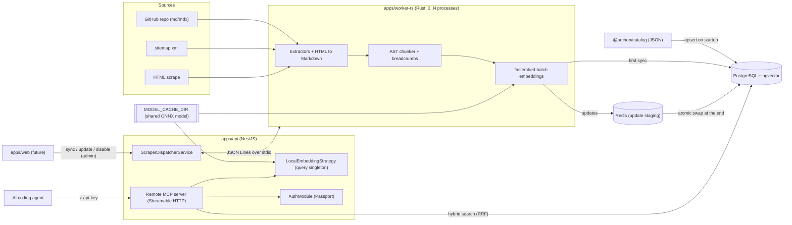
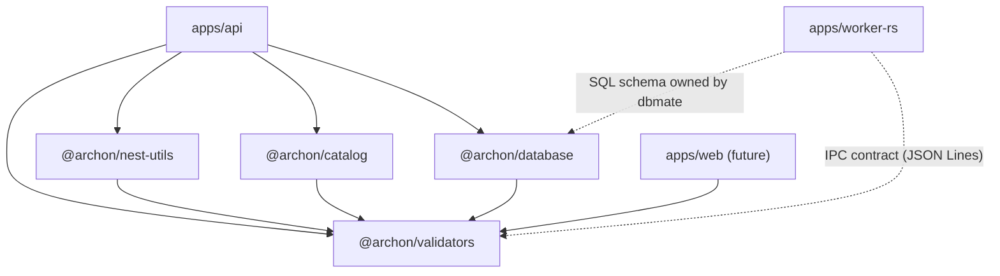
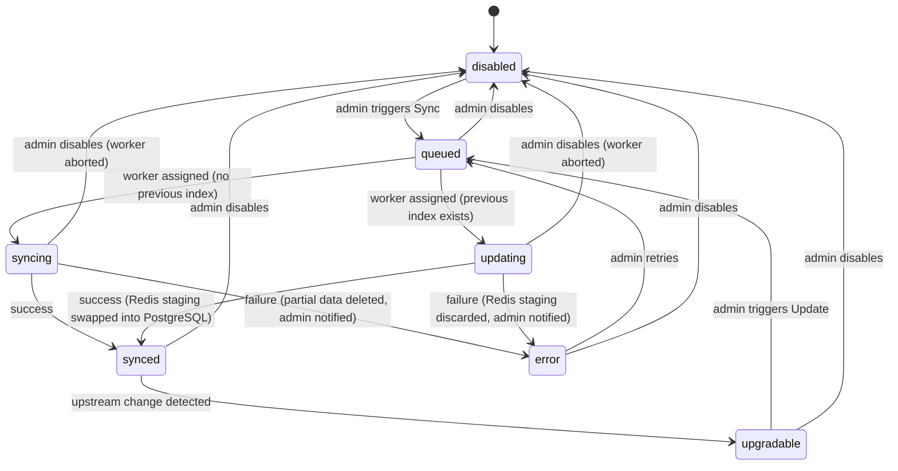
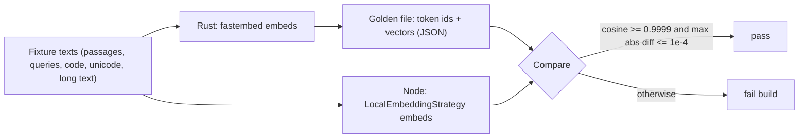

# Archon — Project Overview (Living Document)

> **Status:** Draft / vision document (v2). Nothing described here is implemented yet.
> It merges the *Master Specification* proposal with every decision taken in previous discussions (see §12 Decision Log).
> **Precedence rule:** decisions explicitly stated by the project owner (§12) always win over any written proposal or brief. When something is ambiguous or two sources conflict, **ask before assuming**.
> **Everything here may change** as features go through the SDD cycle. When an approved spec in `specs/<feature>/` contradicts this document, **the approved spec wins** and this document is updated afterwards.

---

## 1. What is Archon?

Archon is a **self-hosted documentation manager** and **remote MCP (Model Context Protocol) server** for AI coding agents, designed to run on small VPS instances (2–4 vCPU, 2–4 GB RAM).

1. **Ingests** technical documentation from GitHub repositories, sitemaps or HTML scraping.
2. **Chunks** it deterministically with semantic Markdown AST parsing and breadcrumb injection.
3. **Embeds** it locally via ONNX with `BAAI/bge-small-en-v1.5` (**384 dimensions**).
4. **Stores** it in PostgreSQL + `pgvector` (vectors) and `tsvector` (full-text).
5. **Exposes hybrid search** (vector + full-text, fused with RRF) to AI agents through a remote MCP endpoint authenticated with API keys.
6. Admins **enable / sync / update / disable** technology versions from a dashboard, keeping disk and RAM usage under strict control.



---

## 2. Monorepo Layout (target: Turborepo + pnpm + Cargo)

| Workspace | Package name | Responsibility |
|---|---|---|
| `apps/api` | `@archon/api` | NestJS backend: catalog sync, auth, worker-pool dispatcher, query embeddings, hybrid search, remote MCP server |
| `apps/worker-rs` | `archon-worker` (Rust binary) | Extraction, HTML→Markdown, AST chunking, batch ONNX embeddings, persistence |
| `apps/web` | `@archon/web` | *Future phase.* Dashboard for API keys and catalog sync toggles |
| `packages/catalog` | `@archon/catalog` | Declarative JSON per technology (`data/*.json`) + build-time validation script |
| `packages/database` | `@archon/database` | Native `pg` pool, `pgvector` registration, raw SQL repositories, dbmate migrations |
| `packages/validators` | `@archon/validators` | Shared Zod schemas + inferred types (catalog, auth, worker IPC, MCP tools, env). **Framework-agnostic** |
| `packages/nest-utils` | `@archon/nest-utils` | Reusable NestJS helpers (e.g. `ZodValidationPipe`) for current and future Nest apps |
| `packages/tsconfig` | `@archon/tsconfig` | Shared TypeScript configurations |
| `Cargo.toml` (root) | — | Rust workspace root managing `apps/worker-rs` |



> [!NOTE]
> `apps/worker-rs` has no TypeScript imports. Its links to `@archon/validators` (IPC contract) and `@archon/database` (schema) are contractual, not code dependencies.

---

## 3. Project-Specific Engineering Rules

These complement `AGENTS.md`, `docs/architecture.md` and `docs/conventions.md`.

1. **English only** for code, identifiers, SQL, comments, error messages and commits.
2. **Zero-ORM:** no Prisma, TypeORM, Drizzle, Sequelize or Kysely. TypeScript uses raw parameterized SQL via `pg` + `pgvector` inside `@archon/database`; Rust uses `tokio-postgres` + `pgvector`.
3. **Migrations:** raw SQL with `-- migrate:up` / `-- migrate:down` in `packages/database/db/migrations/`, managed exclusively by **dbmate**.
4. **Zod everywhere (TS side):** no `class-validator` / `class-transformer`. DTOs, env vars, IPC worker payloads and catalog JSON are validated with Zod schemas from `@archon/validators`.
5. **No generative LLMs in the ingestion pipeline:** HTML cleaning, Markdown conversion, AST chunking and breadcrumb injection are 100% deterministic. The only model in Archon is the embedding encoder.
6. **`@archon/validators` stays framework-agnostic:** Nest-specific helpers go to `@archon/nest-utils`.

---

## 4. Technology Catalog

### 4.1 Behaviour

- One JSON file per technology in `packages/catalog/data/` (initial set: `nestjs.json`, `typescript.json`).
- A check script validates every file against `TechnologyCatalogSchema` at build time.
- On API startup (or manual trigger) the catalog is upserted into `technologies` and `technology_versions`. **Newly discovered versions default to `disabled`**; existing versions keep their status.

### 4.2 Source priority & runtime fallback

| Priority | Source | Behaviour |
|---|---|---|
| 1 | `github` | Clone/fetch `.md` / `.mdx` from `repo` @ `branch` under `docsDir` |
| 2 | `sitemap` | Parse `sitemap.xml`, filter with `allowPatterns` / `ignorePatterns`, extract with `contentSelector` |
| 3 | `scrape` | Crawl from `startUrls` up to `maxDepth`, filter with patterns, extract with `contentSelector` |

- The worker always starts with the highest-priority source defined.
- **A source is considered failed** when it yields **no extracted content** or keeps **throwing errors after several attempts spaced minutes apart** (retry count and delay configurable).
- If it fails and `fallbackOnError` is `true` (default), the worker moves to the next defined source. **Every fallback writes a `sync_logs` entry and sends a notification to the admin.**
- If `fallbackOnError` is `false`, or every defined source fails, the job fails → version goes to `error` (see §5).

### 4.3 Catalog Zod schema (`packages/validators/src/catalog.schema.ts`)

```ts
import { z } from 'zod';

export const GithubSourceSchema = z.object({
  repo: z.string().regex(/^[\w.-]+\/[\w.-]+$/), // e.g. "nestjs/docs.nestjs.com"
  branch: z.string().default('main'),
  docsDir: z.string().default('/'),             // Relative directory inside the repo
});

export const SitemapSourceSchema = z.object({
  url: z.string().url(),
  allowPatterns: z.array(z.string()).optional(),
  ignorePatterns: z.array(z.string()).optional(),
  contentSelector: z.string().default('main, article, body'),
});

export const ManualScrapeSourceSchema = z.object({
  startUrls: z.array(z.string().url()).min(1),
  maxDepth: z.number().int().min(1).max(10).default(3),
  allowPatterns: z.array(z.string()).optional(),
  ignorePatterns: z.array(z.string()).optional(),
  contentSelector: z.string().default('main, article, body'),
});

export const VersionSourcesSchema = z
  .object({
    fallbackOnError: z.boolean().default(true),
    github: GithubSourceSchema.optional(),
    sitemap: SitemapSourceSchema.optional(),
    scrape: ManualScrapeSourceSchema.optional(),
  })
  .refine((data) => Boolean(data.github || data.sitemap || data.scrape), {
    message: 'At least one extraction source (github, sitemap, or scrape) must be defined.',
  });

export const TechnologyVersionSchema = z.object({
  version: z.string(), // e.g. "10.x", "19.0", "latest"
  releaseDate: z.string().optional(),
  sources: VersionSourcesSchema,
});

export const TechnologyCatalogSchema = z.object({
  slug: z.string().regex(/^[a-z0-9-]+$/),
  name: z.string(),
  description: z.string().optional(),
  website: z.string().url().optional(),
  versions: z.array(TechnologyVersionSchema).min(1),
});

export type VersionSources = z.infer<typeof VersionSourcesSchema>;
export type TechnologyVersion = z.infer<typeof TechnologyVersionSchema>;
export type TechnologyCatalog = z.infer<typeof TechnologyCatalogSchema>;
```

---

## 5. Version State Machine & Storage Lifecycle

Seven states. The proposal's 4-state machine is extended with the previously decided `upgradable`, `updating` and `error` states.



| State | Meaning |
|---|---|
| `disabled` | Default. Zero documents/chunks stored |
| `queued` | Persisted in DB and waiting in the dispatcher FIFO queue |
| `syncing` | First-time ingestion by an `archon-worker` process (writes directly to PostgreSQL) |
| `synced` | Fully indexed and searchable |
| `upgradable` | Indexed, but an upstream documentation change has been detected (detection mechanism deferred) |
| `updating` | Re-ingestion in progress; new data is **staged in Redis**, the previous index keeps serving searches |
| `error` | Last job failed. Details in `sync_logs` (summary in `error_message`); admin notified |

### 5.1 Lifecycle rules (decided)

- **Purge policy:** any transition to `disabled` runs `DELETE FROM documents WHERE technology_version_id = $1` (cascading to chunks), freeing disk and HNSW memory.
- **Cancellation:** disabling a `queued` version removes it from the queue; disabling a `syncing` / `updating` version **aborts the worker first**, discards any Redis staging, then purges.
- **First-sync failure:** partial data is deleted, a `sync_logs` entry is written and the admin is notified.
- **Updates:** the worker stages the new documents/chunks in Redis. On success, a single PostgreSQL transaction replaces the old index with the staged one; on failure or crash, the staging is discarded and the old index stays intact.
- **Crash recovery (API startup):**
  - `queued` → reloaded from the DB into the queue, FIFO by `queued_at`.
  - `syncing` → partial data deleted, restarted from scratch.
  - `updating` → Redis staging discarded, restarted from scratch (old index still serving).
- **Write guard (proposed):** the worker's final commit updates the status conditionally (`WHERE id = $1 AND status IN ('syncing', 'updating')`) and rolls back if 0 rows match, so a job cancelled mid-flight can never resurrect data.

---

## 6. Ingestion Engine

### 6.1 NestJS dispatcher (`ScraperDispatcherService`)

- FIFO job queue in memory, **rebuilt from the DB on startup**, plus a pool of `ChildProcess` instances up to `MAX_CONCURRENT_WORKERS` (default `2`).
- **Elastic scaling:** 0 jobs → 0 worker processes; 1 job → 1 worker; 2+ jobs → up to `MAX_CONCURRENT_WORKERS`.
- **Worker reuse:** a worker that finishes a job receives the next one over `stdin`, reusing the ONNX model already in RAM.
- **Scale-to-zero:** after `WORKER_IDLE_TTL_MS` (e.g. 30 000 ms) idle with an empty queue, NestJS closes `stdin` / sends `SHUTDOWN` and the process exits, returning its RAM to the OS.
- **Abort:** NestJS can terminate a worker at any time (disable during sync).

### 6.2 IPC protocol (JSON Lines over stdio)

- **NestJS → worker (`stdin`):** one JSON command per line (e.g. `SYNC_JOB`, `SHUTDOWN`), validated with Zod on the TS side.
- **Worker → NestJS (`stdout`):** status events (`PROGRESS`, `COMPLETED`, `FAILED`, plus fallback events) as JSON lines, validated with Zod when received.
- **`stderr`:** diagnostics only.

### 6.3 Rust pipeline (`apps/worker-rs`)

1. **Startup (once per process):** connect with `tokio-postgres`; load `tokenizer.json` + ONNX model for `bge-small-en-v1.5` from `MODEL_CACHE_DIR` via `fastembed`; ONNX Runtime with `intra_threads = 1` so 2 workers never starve NestJS/PostgreSQL on a 2-vCPU VPS.
2. **Extraction:** `github` (md/mdx), or `reqwest` with rate limiting for `sitemap` / `scrape`; `scraper` crate applies `contentSelector`; `htmd` converts HTML → clean Markdown (no navbars, footers, scripts, styles).
3. **Semantic AST chunking:** `text-splitter` `MarkdownSplitter` with the exact HuggingFace tokenizer; max **400 tokens** per chunk; split by headings and paragraphs; code blocks and tables kept intact unless a single block exceeds 400 tokens.
4. **Breadcrumb injection:** each chunk is prefixed before embedding and storage:
   ```markdown
   [Technology: NestJS 10.x | Document: Guards | Section: ExecutionContext]

   <chunk_markdown_content>
   ```
5. **Embedding stage:** each worker owns **its own model instance** (decided). Batches of `32` through `fastembed`, fed by an internal FIFO queue so extraction and chunking keep progressing while the model is busy.
6. **Persistence:** first sync → PostgreSQL; update → Redis staging, then atomic swap. Emits `COMPLETED` / `FAILED` on `stdout`.

### 6.4 CPU budget & scheduling priority (decided)

Under resource pressure Linux must **always favour the API**, temporarily starving workers if needed. Reference layout for a 4-core VPS:

| Consumer | Target share | Priority |
|---|---|---|
| PostgreSQL | 1 core | Normal |
| NestJS API (incl. query embeddings) | 1 core, may **borrow a 2nd core** for embedding when it is computing a response | Normal (highest effective) |
| Rust workers | 2 cores (1 per worker, `intra_threads = 1`) | **Lowered** (e.g. `nice` 10–19 / lower cgroup `cpu.weight`) |

- The layout is achieved with **scheduling priorities, not hard core pinning**, so idle cores are never wasted: workers use spare CPU freely, but the kernel preempts them as soon as the API (or PostgreSQL) needs CPU.
- The dispatcher spawns workers with reduced priority (e.g. `os.setPriority(pid, 19)` or `nice`), and the API's ONNX session may use up to 2 intra-op threads for query embeddings.
- Exact mechanism (process `nice`, Docker `cpu_shares` / cgroup v2 `cpu.weight`) to be fixed in the `scraper-dispatcher` spec.

---

## 7. Embeddings — Dual-Path Architecture

Ingestion (thousands of chunks) and live queries (one short string) have opposite workload profiles, so Archon uses two runtimes reading **the same model files** from a shared directory.

```text
MODEL_CACHE_DIR (e.g. /var/lib/archon/models)
  └── BAAI/bge-small-en-v1.5 (model.onnx + tokenizer.json)
        ├── Rust worker (fastembed)               → batch ingestion, RAM freed on scale-to-zero
        └── NestJS API (@huggingface/transformers) → live query embeddings, singleton in RAM
```

- **Path 1 — Ingestion:** inside `apps/worker-rs`, only while syncing.
- **Path 2 — Live search:** `LocalEmbeddingStrategy` is a NestJS singleton that loads the quantized model once in `onModuleInit()`. `search_docs` calls `embedQuery()` in-memory (target ≈ 5 ms). Never spawns a worker.
- **BGE query instruction:** queries are prefixed with `"Represent this sentence for searching relevant passages: "`; documents are not.
- **Pooling must match on both paths.** `fastembed` uses **CLS pooling** + L2 normalization for `BGESmallENV15`, so the NestJS side must use `pooling: 'cls', normalize: true` (the proposal said `mean`, which would break query/document compatibility).
- **Same model file:** both runtimes load the exact same `model.onnx` + `tokenizer.json` from `MODEL_CACHE_DIR` (fastembed user-defined model loading on the Rust side).

### 7.1 Embedding parity test (MANDATORY)

Query vectors (Node) and document vectors (Rust) live in the same vector space only if both runtimes produce **the same embeddings**. This is a hard acceptance criterion for the `worker-rs` and `embedding-module` features, and a blocking check in `pnpm turbo run test`.



What it must verify:

1. **Model identity:** SHA-256 of `model.onnx` and `tokenizer.json` is identical for both paths.
2. **Tokenizer parity:** identical token ids for every fixture (also guarantees the 400-token chunk budget is computed the same way).
3. **Passage parity:** Node `embedBatch(text)` ≈ Rust embedding of `text` (no prefix).
4. **Query parity:** Node `embedQuery(q)` ≈ Rust embedding of `"Represent this sentence for searching relevant passages: " + q`.
5. **Normalization:** every vector has 384 dimensions and L2 norm ≈ 1.
6. **Fixtures cover edge cases:** short queries, code blocks, Markdown tables, breadcrumb-prefixed chunks, non-ASCII text, and texts near the 512-token limit (truncation behaviour).

Tolerances above are proposals to be fixed in the spec. Golden files are produced by a Rust command and checked by a Node test; regenerating them must be an explicit action (a model change requires regenerating golden files and re-embedding all versions).

```ts
export const EMBEDDING_STRATEGY = Symbol('EMBEDDING_STRATEGY');

export interface EmbeddingStrategy {
  readonly modelName: string;
  readonly dimensions: number;
  embedQuery(query: string): Promise<number[]>;
  embedBatch(texts: string[]): Promise<number[][]>;
}
```

*Future:* `EMBEDDING_PROVIDER=openai` swaps the NestJS DI provider and instructs the Rust worker (via IPC payload) to call an external API instead of local ONNX.

---

## 8. Authentication, Authorization & MCP

### 8.1 Authentication

- `users` decoupled from `user_identities` (`local`, `github`, `google`, …).
- `LocalStrategy` (email + bcrypt), `GithubStrategy` (OAuth2 linking/creation), `JwtStrategy` (dashboard Bearer tokens), `ApiKeyStrategy` (SHA-256 of `x-api-key` matched against `api_keys.key_hash` where `revoked_at IS NULL`).

### 8.2 Authorization (decided)

- `users.role`: `admin` | `user`. Only **admins** can sync, update or disable versions (global effect).
- **Admin bootstrap:** created on startup from env vars (e.g. `ADMIN_EMAIL`, `ADMIN_PASSWORD`) if that admin does not exist yet. Once created, the env vars can be removed for security; their absence must not break startup.

### 8.3 Remote MCP server

Served from `apps/api` over **Streamable HTTP only** (no legacy SSE), protected by `ApiKeyGuard`.

| Tool | Input | Output |
|---|---|---|
| `list_synced_technologies` | — | Technologies/versions with a searchable index |
| `check_technology_status` | `{ technology, version? }` | Existence in catalog + current status (all 7 states) |
| `search_docs` | `{ technology, version, query, limit? }` | Hybrid search (vector + FTS with RRF) top results |
| `get_doc_page` | `{ documentId }` | Full document or ordered chunks |

### 8.4 Reference hybrid search query (RRF)

```sql
WITH vector_matches AS (
    SELECT c.id, ROW_NUMBER() OVER (ORDER BY c.embedding <=> $1) AS rank_ix
    FROM document_chunks c
    WHERE c.technology_version_id = $2
    ORDER BY c.embedding <=> $1
    LIMIT 20
),
fts_matches AS (
    SELECT c.id,
           ROW_NUMBER() OVER (ORDER BY ts_rank_cd(c.search_vector, websearch_to_tsquery('english', $3)) DESC) AS rank_ix
    FROM document_chunks c
    WHERE c.technology_version_id = $2
      AND c.search_vector @@ websearch_to_tsquery('english', $3)
    ORDER BY ts_rank_cd(c.search_vector, websearch_to_tsquery('english', $3)) DESC
    LIMIT 20
)
SELECT c.id, c.document_id AS "documentId", d.url, d.title, c.content, c.chunk_index AS "chunkIndex",
       COALESCE(1.0 / (60 + v.rank_ix), 0.0) + COALESCE(1.0 / (60 + f.rank_ix), 0.0) AS rrf_score
FROM vector_matches v
FULL OUTER JOIN fts_matches f ON v.id = f.id
JOIN document_chunks c ON c.id = COALESCE(v.id, f.id)
JOIN documents d ON d.id = c.document_id
ORDER BY rrf_score DESC
LIMIT $4;
```

---

## 9. Data Model (reference migration)

Proposal schema + previously decided additions (`user_role`, 7-state `sync_status`, `queued_at`, `sync_logs`).

```sql
-- migrate:up
CREATE EXTENSION IF NOT EXISTS "pgcrypto";
CREATE EXTENSION IF NOT EXISTS "vector";

-- 1. Auth
CREATE TYPE user_role AS ENUM ('admin', 'user');

CREATE TABLE users (
    id UUID PRIMARY KEY DEFAULT gen_random_uuid(),
    email TEXT UNIQUE NOT NULL,
    name TEXT,
    role user_role NOT NULL DEFAULT 'user',
    created_at TIMESTAMPTZ NOT NULL DEFAULT NOW(),
    updated_at TIMESTAMPTZ NOT NULL DEFAULT NOW()
);

CREATE TABLE user_identities (
    id UUID PRIMARY KEY DEFAULT gen_random_uuid(),
    user_id UUID NOT NULL REFERENCES users(id) ON DELETE CASCADE,
    provider TEXT NOT NULL,
    provider_user_id TEXT NOT NULL,
    credential_hash TEXT,
    metadata JSONB NOT NULL DEFAULT '{}'::jsonb,
    created_at TIMESTAMPTZ NOT NULL DEFAULT NOW(),
    UNIQUE(provider, provider_user_id)
);

CREATE TABLE api_keys (
    id UUID PRIMARY KEY DEFAULT gen_random_uuid(),
    user_id UUID NOT NULL REFERENCES users(id) ON DELETE CASCADE,
    name TEXT NOT NULL,
    key_prefix TEXT NOT NULL,
    key_hash TEXT UNIQUE NOT NULL,
    last_used_at TIMESTAMPTZ,
    created_at TIMESTAMPTZ NOT NULL DEFAULT NOW(),
    revoked_at TIMESTAMPTZ
);

-- 2. Catalog & sync state
CREATE TYPE sync_status AS ENUM ('disabled', 'queued', 'syncing', 'synced', 'upgradable', 'updating', 'error');

CREATE TABLE technologies (
    id UUID PRIMARY KEY DEFAULT gen_random_uuid(),
    slug TEXT UNIQUE NOT NULL,
    name TEXT NOT NULL,
    description TEXT,
    website TEXT,
    created_at TIMESTAMPTZ NOT NULL DEFAULT NOW(),
    updated_at TIMESTAMPTZ NOT NULL DEFAULT NOW()
);

CREATE TABLE technology_versions (
    id UUID PRIMARY KEY DEFAULT gen_random_uuid(),
    technology_id UUID NOT NULL REFERENCES technologies(id) ON DELETE CASCADE,
    version TEXT NOT NULL,
    sources JSONB NOT NULL,
    status sync_status NOT NULL DEFAULT 'disabled',
    queued_at TIMESTAMPTZ,
    last_synced_at TIMESTAMPTZ,
    error_message TEXT,
    created_at TIMESTAMPTZ NOT NULL DEFAULT NOW(),
    updated_at TIMESTAMPTZ NOT NULL DEFAULT NOW(),
    UNIQUE(technology_id, version)
);

CREATE TYPE log_level AS ENUM ('info', 'warn', 'error');

CREATE TABLE sync_logs (
    id UUID PRIMARY KEY DEFAULT gen_random_uuid(),
    technology_version_id UUID NOT NULL REFERENCES technology_versions(id) ON DELETE CASCADE,
    level log_level NOT NULL,
    event TEXT NOT NULL,              -- e.g. 'source_fallback', 'sync_failed', 'sync_completed'
    message TEXT NOT NULL,
    details JSONB NOT NULL DEFAULT '{}'::jsonb,
    created_at TIMESTAMPTZ NOT NULL DEFAULT NOW()
);

CREATE INDEX idx_sync_logs_version ON sync_logs(technology_version_id, created_at DESC);

-- 3. Documents & chunks (384 dims, bge-small-en-v1.5)
CREATE TABLE documents (
    id UUID PRIMARY KEY DEFAULT gen_random_uuid(),
    technology_version_id UUID NOT NULL REFERENCES technology_versions(id) ON DELETE CASCADE,
    source_type TEXT NOT NULL,
    url TEXT NOT NULL,
    title TEXT,
    content_hash TEXT NOT NULL,
    metadata JSONB NOT NULL DEFAULT '{}'::jsonb,
    created_at TIMESTAMPTZ NOT NULL DEFAULT NOW(),
    UNIQUE(technology_version_id, url)
);

CREATE TABLE document_chunks (
    id UUID PRIMARY KEY DEFAULT gen_random_uuid(),
    document_id UUID NOT NULL REFERENCES documents(id) ON DELETE CASCADE,
    technology_version_id UUID NOT NULL REFERENCES technology_versions(id) ON DELETE CASCADE,
    chunk_index INT NOT NULL,
    content TEXT NOT NULL,
    token_count INT NOT NULL,
    embedding vector(384) NOT NULL,
    search_vector tsvector GENERATED ALWAYS AS (to_tsvector('english', content)) STORED,
    created_at TIMESTAMPTZ NOT NULL DEFAULT NOW()
);

CREATE INDEX idx_chunks_version_id ON document_chunks(technology_version_id);
CREATE INDEX idx_chunks_document_id ON document_chunks(document_id);
CREATE INDEX idx_chunks_fts ON document_chunks USING gin(search_vector);
CREATE INDEX idx_chunks_embedding_hnsw ON document_chunks
USING hnsw (embedding vector_cosine_ops) WITH (m = 16, ef_construction = 64);

-- migrate:down
DROP TABLE IF EXISTS document_chunks;
DROP TABLE IF EXISTS documents;
DROP TABLE IF EXISTS sync_logs;
DROP TYPE IF EXISTS log_level;
DROP TABLE IF EXISTS technology_versions;
DROP TYPE IF EXISTS sync_status;
DROP TABLE IF EXISTS technologies;
DROP TABLE IF EXISTS api_keys;
DROP TABLE IF EXISTS user_identities;
DROP TABLE IF EXISTS users;
DROP TYPE IF EXISTS user_role;
```

> [!NOTE]
> The proposal's `idx_identities_lookup (provider, provider_user_id)` was dropped: the `UNIQUE(provider, provider_user_id)` constraint already creates an identical index.

### 9.1 Tentative environment variables

| Variable | Purpose |
|---|---|
| `DATABASE_URL` | PostgreSQL connection (API, worker, dbmate) |
| `REDIS_URL` | Redis for update staging |
| `MODEL_CACHE_DIR` | Shared ONNX model directory |
| `MAX_CONCURRENT_WORKERS` | Worker pool cap (default `2`) |
| `WORKER_IDLE_TTL_MS` | Scale-to-zero idle TTL (e.g. `30000`) |
| `SOURCE_RETRY_ATTEMPTS` / `SOURCE_RETRY_DELAY_MS` | Retries before a source is considered failed |
| `ADMIN_EMAIL` / `ADMIN_PASSWORD` | Optional, one-time admin bootstrap |
| `JWT_SECRET` | Dashboard JWT signing |
| `GITHUB_CLIENT_ID` / `GITHUB_CLIENT_SECRET` | GitHub OAuth |
| `GITHUB_TOKEN` | Optional, raises GitHub rate limits for extraction |
| `EMBEDDING_PROVIDER` | `local` (default); future `openai`, `voyage` |

---

## 10. Phase 1 Roadmap (candidate features)

Each item is a **candidate** for `feature_list.json` (one feature at a time, SDD applies).

| # | Candidate feature | Depends on |
|---|---|---|
| 1 | `workspace-config` — `packages/tsconfig`, root `Cargo.toml`, Rust integrated in Turborepo tasks | — |
| 2 | `validators-core` — catalog, auth, worker IPC, MCP tools, env schemas | 1 |
| 3 | `nest-utils` — `@archon/nest-utils` with `ZodValidationPipe` | 2 |
| 4 | `catalog-package` — `nestjs.json`, `typescript.json` + validation script | 2 |
| 5 | `database-package` — dbmate migrations, `pg` pool, pgvector registration, repositories (incl. hybrid search) | 2 |
| 6 | `worker-rs` — Rust binary: IPC, extractors with retries/fallback, HTML→MD, AST chunking, breadcrumbs, embeddings, persistence (PG + Redis staging) | 1, 2, 5 |
| 7 | `api-bootstrap` — NestJS app, env validation, `DatabaseModule` | 3, 5 |
| 8 | `catalog-sync` — `CatalogSyncService` | 4, 7 |
| 9 | `auth` — Passport strategies, roles, admin bootstrap, API keys | 7 |
| 10 | `embedding-module` — `LocalEmbeddingStrategy` query singleton (`pooling: 'cls'`) + mandatory Rust ↔ Node parity test (§7.1) | 6, 7 |
| 11 | `scraper-dispatcher` — persisted FIFO queue, worker pool (lowered OS priority), reuse, scale-to-zero, state machine, cancellation, crash recovery, logs, admin notifications | 6, 8, 9 |
| 12 | `mcp-server` — Streamable HTTP endpoint + 4 tools + hybrid search | 9, 10, 11 |
| — | *Later:* upstream change detection (`synced → upgradable`), notification channels, `apps/web` | — |

> [!NOTE]
> Items 6 and 11 are large and will likely be split (e.g. `worker-rs-ipc`, `worker-rs-extractors`, `worker-rs-embeddings`) when specs are written.

---

## 11. Open Questions & Design Risks

### 11.1 Lifecycle

1. **Which states are searchable?** Proposal: any version with a committed index (`last_synced_at IS NOT NULL` and status ≠ `disabled`), so `upgradable`, `updating`, `queued`-for-update and update-`error` keep serving the old index.
2. **Retries "minutes apart":** does the worker hold its slot while waiting, or is the job re-queued with a delay so other versions can progress?
3. **Admin notification channel:** dashboard inbox, email, webhook…?
4. **Redis footprint on small VPS:** staging a whole version (chunks + 384-dim vectors) in Redis adds RAM and a new service. Alternative without Redis: staging rows in PostgreSQL with a generation/swap flag. Kept as decided (Redis) unless revisited.
5. **Change detection** for `synced → upgradable` (commit SHA, sitemap `<lastmod>`, content hashes; periodic vs manual) — deferred.
6. **Incremental updates:** `content_hash` would allow re-embedding only changed documents.
7. **Horizontal scaling:** the in-memory queue assumes a single API instance.

### 11.2 Rust worker & toolchain

8. **IPC contract drift:** Zod validates only on the TS side. Options: generate JSON Schema from Zod (Zod 4 `z.toJSONSchema`) and derive/validate Rust `serde` types, or contract tests on fixtures.
9. **Rust inside the harness:** `apps/worker-rs` needs a `package.json` wrapper so `pnpm turbo run build|lint|typecheck|test` runs `cargo build|clippy|check|test`. `docs/conventions.md` and `docs/verification.md` need Rust sections.
10. **ONNX Runtime binaries:** `ort`/`fastembed` download native libraries at build time; verify Windows (dev) and Linux (VPS) builds, plus Docker image strategy.
11. **Model provisioning:** who downloads `model.onnx` + `tokenizer.json` into `MODEL_CACHE_DIR` (setup script, first boot, offline installs).
12. **Who owns state transitions:** proposal lets the worker set `synced`; recommended to keep NestJS as orchestrator and use the conditional write guard (§5.1).

### 11.3 Chunking & search

13. **Token budget:** 400 tokens + breadcrumb + `[CLS]/[SEP]` must stay ≤ 512; breadcrumb tokens should be counted.
14. **Breadcrumbs vs `get_doc_page`:** breadcrumbs stored inside `content` will repeat when reconstructing a page. Options: separate `breadcrumb` column, or full Markdown stored in `documents`.
15. **FTS dictionary:** `'english'` stems identifiers (`CanActivate` → `canactiv`). Consider `'simple'` (or both) for exact symbol matches.
16. **Filtered HNSW:** `WHERE technology_version_id = $2` with HNSW may return fewer than 20 candidates; use pgvector ≥ 0.8 iterative scans or tune `hnsw.ef_search`.
17. **Purge bloat:** mass deletes leave HNSW tombstones; plan `VACUUM` after purges/swaps.

### 11.4 Catalog, extraction & auth

18. Behaviour when a version/technology is **removed** from the catalog, or its `sources` **change** (could map to `upgradable`).
19. How `@archon/catalog` ships JSON at runtime (generated TS index vs reading `data/`).
20. GitHub: clone vs tarball, rate limits (`GITHUB_TOKEN`), mapping file paths to public docs URLs, MDX/JSX stripping.
21. Scraping: robots.txt, max pages, JS-rendered (SPA) sites.
22. GitHub users without public email vs `users.email NOT NULL`; API key prefix format (`archon_live_...` vs `archon_7f8a`).

### 11.5 Infrastructure

23. Zod major version (Zod 4 API changes), ESM vs CJS for NestJS, `docker-compose` (pgvector + Redis), dbmate via npm, DB integration test strategy.

---

## 12. Decision Log

| Date | Topic | Decision |
|---|---|---|
| 2026-11-07 | Re-sync & failures | New states `upgradable`, `updating`, `error`; failures write to `sync_logs`. Change detection deferred. |
| 2026-11-07 | Disable during sync | Disabling aborts the in-flight job before purging. |
| 2026-11-07 | Crash recovery | `queued` persisted in DB and reloaded; `syncing` restarts from scratch after deleting partial data. |
| 2026-11-07 | ~~Embedding dimensions: 768~~ | **Superseded** by the `bge-small-en-v1.5` decision (384). |
| 2026-11-07 | Model access & per-worker queue | One ONNX model instance per Rust worker (fed by an internal FIFO queue inside each worker so extraction continues while embedding) + 1 singleton in the NestJS API for live queries. |
| 2026-11-07 | Source fallback | Priority chain `github` → `sitemap` → `scrape`; now controlled by `fallbackOnError` (default `true`). |
| 2026-11-07 | MCP transport | Streamable HTTP only (overrides "SSE / Streamable HTTP" in the proposal). |
| 2026-11-07 | NestJS helpers | `ZodValidationPipe` lives in `@archon/nest-utils` (overrides "export from validators" in the proposal). |
| 2026-11-07 | Authorization | Only admins can sync, update or disable versions. |
| 2026-11-07 | Serving during updates | Previous index keeps serving; new data staged in Redis and swapped in at the end. |
| 2026-11-07 | First-sync failure | Partial data deleted, log written, admin notified. |
| 2026-11-07 | Source failure definition | Empty extraction or errors after several retries minutes apart; each fallback logged and notified to the admin. |
| 2026-11-07 | Admin bootstrap | Via env vars; they can be removed after the admin exists. |
| 2026-11-07 | Embedding model | `BAAI/bge-small-en-v1.5`, 384 dims, ONNX local. |
| 2026-11-07 | Master spec v2 | Adopted: Rust worker (`apps/worker-rs`), dual-path embeddings, AST chunking (400 tokens) with breadcrumbs, hybrid search with RRF, no generative LLMs in ingestion. |
| 2026-11-07 | Precedence rule | Explicit user instructions always take precedence over pasted briefs/proposals; ask when in doubt. |
| 2026-11-07 | Linux CPU budget & priority | Reference 4-core layout: 1 core PostgreSQL, 1 core API (bursting onto a 2nd core when computing a query embedding), 2 cores Rust workers (`intra_threads = 1` each). Linux scheduler always prioritizes PG/API, temporarily throttling workers under contention (§6.4). |
| 2026-11-07 | Pooling & parity test | Both Rust (`fastembed`) and Node (`@huggingface/transformers`) use CLS pooling (`pooling: 'cls', normalize: true`) over the same `model.onnx` + `tokenizer.json`. Enforced by a mandatory cross-runtime parity test (§7.1). |
