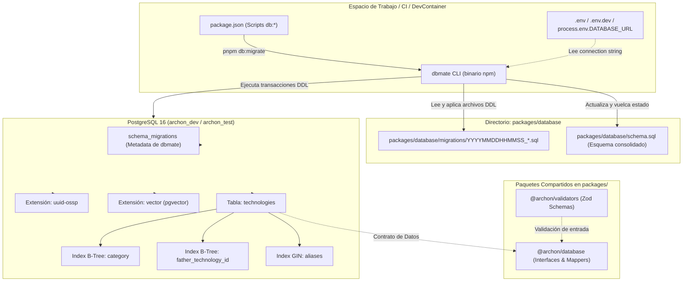

# Design — dbmate-technologies-migration

## 1. Arquitectura General y Topología del Sistema de Migraciones

La gestión del ciclo de vida del esquema de base de datos relacional se implementa utilizando **dbmate**, una herramienta ligera, precompilada, agnóstica del framework y orientada a scripts SQL declarativos. Esto garantiza que las definiciones DDL sean la única fuente de verdad (*single source of truth*) tanto en desarrollo local, en contenedores de desarrollo (`.devcontainer`), en entornos de CI/CD como en producción.

Las migraciones residen directamente dentro del paquete `@archon/database` en `packages/database/migrations/` (sin directorio `/db` intermedio), y el volcado de esquema consolidado se genera en `packages/database/schema.sql`. Los scripts npm de orquestación se exponen en la raíz del workspace apuntando de forma explícita y determinista a estas rutas.



---

## 2. Componentes y Paquetes Afectados

### 2.1 Raíz del Monorepo (`/`)

1. **`package.json`**:
   - Dependencia de desarrollo: `"dbmate": "^2.38.0"`.
   - Scripts de ciclo de vida de base de datos:
     ```json
     {
       "scripts": {
         "db:migrate": "dbmate --migrations-dir packages/database/migrations --schema-file packages/database/schema.sql up",
         "db:migrate:dev": "dbmate --env-file .env.dev --migrations-dir packages/database/migrations --schema-file packages/database/schema.sql up",
         "db:rollback": "dbmate --migrations-dir packages/database/migrations --schema-file packages/database/schema.sql down",
         "db:rollback:dev": "dbmate --env-file .env.dev --migrations-dir packages/database/migrations --schema-file packages/database/schema.sql down",
         "db:status": "dbmate --migrations-dir packages/database/migrations --schema-file packages/database/schema.sql status",
         "db:status:dev": "dbmate --env-file .env.dev --migrations-dir packages/database/migrations --schema-file packages/database/schema.sql status",
         "db:new": "dbmate --migrations-dir packages/database/migrations new"
       }
     }
     ```
   - La inclusión explícita de los flags `--migrations-dir` y `--schema-file` asegura un comportamiento determinista apuntando directamente a `packages/database/migrations` y `packages/database/schema.sql` independientemente del directorio actual de ejecución o de la plataforma (Windows / Linux / macOS).

### 2.2 Paquete de Base de Datos (`packages/database`)

1. **Estructura de Directorios de Migración**:
   - `packages/database/migrations/`: Directorio versionado en Git donde se almacenan directamente los archivos `.sql` de migración generados cronológicamente por `dbmate new`.
   - `packages/database/schema.sql`: Archivo consolidado del esquema final de PostgreSQL, generado y actualizado automáticamente por `dbmate` tras cada ejecución exitosa de `up`.

2. **`packages/database/src/technology.ts`**:
   - Interfaces TypeScript: `TechnologyRow` (representación SQL exacta en PostgreSQL) y `Technology` (modelo de dominio de aplicación con nomenclatura camelCase).
   - Funciones puras de transformación:
     - `mapTechnologyRowToEntity(row: TechnologyRow): Technology`
     - `mapEntityToTechnologyRow(entity: Technology): TechnologyRow`

3. **`packages/database/src/index.ts`**:
   - Re-exportación de interfaces de modelo, funciones de mapeo e infraestructura relacional.

### 2.3 Paquete de Validadores (`packages/validators`)

1. **`packages/validators/src/technology.ts`**:
   - Definición de esquemas Zod para la entidad `Technology`.
   - Validación inlinada de categoría (`z.string().trim().min(1).max(32)`) directamente en los esquemas sin abstracciones intermedias innecesarias (KISS / YAGNI).
   - `TechnologySchema`: Validación canónica completa del modelo de tecnología.
   - `CreateTechnologySchema`: Validación del payload de creación (campos requeridos, normalización de alias opcionales y compatibilidad de nombres).
   - `UpdateTechnologySchema`: Validación parcial para operaciones de actualización.
   - `TechnologyRowSchema`: Validación estricta de la estructura de fila retornada por el driver relacional `pg`.

2. **`packages/validators/src/index.ts`**:
   - Re-exportación pública de todos los esquemas y tipos inferidos de `technology.ts`.

---

## 3. Especificación DDL SQL de la Migración

### 3.1 Nombre y Estructura del Archivo de Migración

Ruta canónica: `packages/database/migrations/20261110000000_create_technologies_table.sql`

```sql
-- migrate:up
CREATE EXTENSION IF NOT EXISTS "uuid-ossp";
CREATE EXTENSION IF NOT EXISTS vector;

CREATE TABLE technologies (
    id UUID PRIMARY KEY DEFAULT gen_random_uuid(),
    name VARCHAR(100) NOT NULL,
    category VARCHAR(32) NOT NULL,
    father_technology_id UUID REFERENCES technologies(id) ON DELETE CASCADE,
    description TEXT,
    slug VARCHAR(64) NOT NULL UNIQUE,
    is_activate BOOLEAN NOT NULL DEFAULT true,
    aliases TEXT[] NOT NULL DEFAULT '{}',
    created_at TIMESTAMPTZ NOT NULL DEFAULT CURRENT_TIMESTAMP,
    updated_at TIMESTAMPTZ NOT NULL DEFAULT CURRENT_TIMESTAMP
);

CREATE INDEX idx_technologies_category ON technologies (category);
CREATE INDEX idx_technologies_father_technology_id ON technologies (father_technology_id);
CREATE INDEX idx_technologies_aliases_gin ON technologies USING gin (aliases);

-- migrate:down
DROP TABLE IF EXISTS technologies CASCADE;
```

### 3.2 Decisiones de Diseño DDL y Nomenclatura Relacional

1. **Resolución de Nomenclatura (`father_technology_id` vs `fatherTecnology`):**
   - En PostgreSQL, los identificadores que no están encerrados entre comillas dobles se convierten automáticamente a minúsculas (`fathertecnology`).
   - Usar comillas forzadas (`"fatherTecnology"`) crea severos problemas de ergonomía y fragilidad, obligando a escapar comillas en cada consulta SQL, vista o script manual.
   - Siguiendo los estándares internacionales de PostgreSQL y las convenciones del monorepo (`docs/conventions.md`), la columna en base de datos se denomina en `snake_case`: **`father_technology_id`**.
   - En la capa de TypeScript y contratos Zod, la propiedad de dominio se expone como `fatherTechnologyId`, y los esquemas de entrada admiten de forma transparente tanto `fatherTechnologyId`, `father_technology_id` como el alias `fatherTecnology` para compatibilidad completa con cualquier payload.

2. **Uso de Claves Primarias UUID:**
   - La clave primaria utiliza el tipo nativo `UUID` con valor predeterminado `gen_random_uuid()`. Esta función está incorporada en el núcleo de PostgreSQL (a partir de PostgreSQL 13), sin requerir dependencias externas de funciones de generación. Se incluye adicionalmente `CREATE EXTENSION IF NOT EXISTS "uuid-ossp";` para máxima compatibilidad con utilidades heredadas.

3. **Habilitación de la Extensión `vector`:**
   - Siguiendo la arquitectura definida en `specs/devcontainer-environment/design.md`, el script `.devcontainer/init-db.sql` delegó explícitamente la activación de extensiones al sistema de migraciones. Esta primera migración ejecuta `CREATE EXTENSION IF NOT EXISTS vector;` asegurando que la base de datos esté lista para futuras tablas con embeddings vectoriales sin requerir intervención manual.

4. **Índices y Optimización de Rendimiento:**
   - **B-Tree en `category`:** Acelera el filtrado y segmentación por categoría tecnológica (e.g. `WHERE category = 'language'`).
   - **B-Tree en `father_technology_id`:** Crucial para optimizar consultas de jerarquías (e.g. obtener todas las tecnologías hijas de una tecnología dada) y acelerar las comprobaciones de integridad referencial durante operaciones `ON DELETE CASCADE`.
   - **GIN en `aliases`:** PostgreSQL soporta de forma nativa la indexación GIN sobre tipos de array (`TEXT[]`) mediante las clases de operadores integradas (`array_ops`). Esto permite consultas ultra rápidas con operadores de solapamiento o contención:
     ```sql
     -- Búsqueda de coincidencia en alias con índice GIN
     SELECT * FROM technologies WHERE aliases @> ARRAY['ts'::text];
     SELECT * FROM technologies WHERE aliases && ARRAY['postgres'::text, 'pgsql'::text];
     ```

5. **Regla de Eliminación `ON DELETE CASCADE`:**
   - Al eliminar una tecnología padre (e.g. `SQL`), todas sus tecnologías dependientes o sub-tecnologías registradas bajo esa jerarquía se eliminan de forma atómica y consistente, impidiendo inconsistencias o registros huérfanos.

6. **Marcas Temporales con Zona Horaria (`TIMESTAMPTZ`):**
   - Se utiliza `TIMESTAMPTZ` en lugar de `TIMESTAMP` para almacenar el instante UTC absoluto con precisión de microsegundos, evitando ambigüedades derivadas del cambio de husos horarios entre servidores y clientes.

---

## 4. Schemas Zod y Tipos TypeScript

### 4.1 Paquete `@archon/validators`

```typescript
import { z } from 'zod';

/**
 * Esquema representativo de una fila directa de PostgreSQL (snake_case).
 */
export const TechnologyRowSchema = z.object({
  id: z.string().uuid(),
  name: z.string().min(1).max(100),
  category: z.string().trim().min(1).max(32),
  father_technology_id: z.string().uuid().nullable(),
  description: z.string().nullable(),
  slug: z.string().min(1).max(64),
  is_activate: z.boolean(),
  aliases: z.array(z.string()),
  created_at: z.date().or(z.string().datetime()),
  updated_at: z.date().or(z.string().datetime()),
});

export type TechnologyRow = z.infer<typeof TechnologyRowSchema>;

/**
 * Esquema canónico de la entidad de dominio Technology (camelCase).
 */
export const TechnologySchema = z.object({
  id: z.string().uuid(),
  name: z.string().min(1).max(100),
  category: z.string().trim().min(1).max(32),
  fatherTechnologyId: z.string().uuid().nullable(),
  description: z.string().nullable().optional(),
  slug: z
    .string()
    .min(1)
    .max(64)
    .regex(/^[a-z0-9]+(?:-[a-z0-9]+)*$/, 'El slug debe ser kebab-case en minúsculas'),
  isActivate: z.boolean().default(true),
  aliases: z.array(z.string()).default([]),
  createdAt: z.date().or(z.string().datetime()),
  updatedAt: z.date().or(z.string().datetime()),
});

export type Technology = z.infer<typeof TechnologySchema>;

/**
 * Esquema para la creación de una nueva tecnología.
 * Admite 'fatherTechnologyId', 'father_technology_id' y 'fatherTecnology' mediante preprocess/transform.
 */
export const CreateTechnologySchema = z
  .object({
    name: z.string().trim().min(1).max(100),
    category: z.string().trim().min(1).max(32),
    fatherTechnologyId: z.string().uuid().nullable().optional(),
    father_technology_id: z.string().uuid().nullable().optional(),
    fatherTecnology: z.string().uuid().nullable().optional(),
    description: z.string().trim().nullable().optional(),
    slug: z
      .string()
      .trim()
      .min(1)
      .max(64)
      .regex(/^[a-z0-9]+(?:-[a-z0-9]+)*$/, 'El slug debe ser kebab-case en minúsculas'),
    isActivate: z.boolean().optional().default(true),
    is_activate: z.boolean().optional(),
    aliases: z.array(z.string()).trim().optional().default([]),
  })
  .transform((data) => {
    const fatherId =
      data.fatherTechnologyId ?? data.father_technology_id ?? data.fatherTecnology ?? null;
    const active = data.isActivate ?? data.is_activate ?? true;
    return {
      name: data.name,
      category: data.category,
      fatherTechnologyId: fatherId,
      description: data.description ?? null,
      slug: data.slug,
      isActivate: active,
      aliases: data.aliases,
    };
  });

export type CreateTechnologyInput = z.input<typeof CreateTechnologySchema>;
export type CreateTechnologyOutput = z.output<typeof CreateTechnologySchema>;

/**
 * Esquema para la actualización parcial de una tecnología.
 */
export const UpdateTechnologySchema = z.object({
  name: z.string().trim().min(1).max(100).optional(),
  category: z.string().trim().min(1).max(32).optional(),
  fatherTechnologyId: z.string().uuid().nullable().optional(),
  description: z.string().trim().nullable().optional(),
  slug: z
    .string()
    .trim()
    .min(1)
    .max(64)
    .regex(/^[a-z0-9]+(?:-[a-z0-9]+)*$/, 'El slug debe ser kebab-case en minúsculas')
    .optional(),
  isActivate: z.boolean().optional(),
  aliases: z.array(z.string()).trim()).optional(),
});

export type UpdateTechnologyInput = z.infer<typeof UpdateTechnologySchema>;
```

### 4.2 Paquete `@archon/database`

```typescript
import type { TechnologyRow, Technology } from '@archon/validators';

/**
 * Mapea una fila relacional devuelta por PostgreSQL (TechnologyRow) al modelo de dominio (Technology).
 */
export function mapTechnologyRowToEntity(row: TechnologyRow): Technology {
  return {
    id: row.id,
    name: row.name,
    category: row.category,
    fatherTechnologyId: row.father_technology_id,
    description: row.description,
    slug: row.slug,
    isActivate: row.is_activate,
    aliases: Array.isArray(row.aliases) ? row.aliases : [],
    createdAt: row.created_at,
    updatedAt: row.updated_at,
  };
}

/**
 * Mapea una entidad de dominio (Technology) a su representación de fila relacional en base de datos.
 */
export function mapEntityToTechnologyRow(entity: Technology): TechnologyRow {
  return {
    id: entity.id,
    name: entity.name,
    category: entity.category,
    father_technology_id: entity.fatherTechnologyId,
    description: entity.description ?? null,
    slug: entity.slug,
    is_activate: entity.isActivate,
    aliases: entity.aliases,
    created_at: entity.createdAt,
    updated_at: entity.updatedAt,
  };
}
```

---

## 5. Manejo de Errores y Excepciones de Dominio

1. **Errores de Validación Zod (`ZodError`):**
   - Emitidos automáticamente cuando un payload no cumple las restricciones definidas (e.g., longitud de `name > 100`, `category > 32`, `slug` con caracteres en mayúsculas o espacios, `fatherTechnologyId` que no sea un UUID válido).
   - Proporciona un array de `issues` con el camino exacto (`path`) del campo causante y el mensaje descriptivo.

2. **Violación de Clave Única en PostgreSQL (Código `23505` - `unique_violation`):**
   - Ocurre si se intenta insertar o actualizar un registro con un `slug` que ya existe en la tabla `technologies`.
   - La capa de persistencia debe capturar el error con código `23505` y mapearlo a una excepción semántica de dominio `DuplicateTechnologySlugError`.

3. **Violación de Clave Foránea en PostgreSQL (Código `23503` - `foreign_key_violation`):**
   - Ocurre si se suministra un `father_technology_id` que no corresponde a ningún registro existente en la tabla `technologies`.
   - La capa de persistencia debe capturar el error `23503` y transformarlo en `ParentTechnologyNotFoundError`.

4. **Errores de Ejecución de Migraciones dbmate:**
   - Si la cadena de conexión `DATABASE_URL` es inalcanzable, o si un script SQL contiene un error de sintaxis, el comando `dbmate` emite un código de salida distinto de cero (`exit code != 0`) imprimiendo la causa exacta del fallo por `stderr`. Esto asegura que los scripts de Turborepo y pipelines de CI interrumpan el proceso impidiendo despliegues inconsistentes.

---

## 6. Alternativas Descartadas

### Alternativa 1 (Descartada): Usar un ORM Pesado (Prisma / TypeORM) para la Gestión de Migraciones
- **Descripción:** Configurar Prisma o TypeORM con sus respectivos motores de migración propios en lugar de dbmate.
- **Justificación de Descarte:**
  - Prisma y TypeORM imponen una capa de abstracción pesada con binarios propietarios o generadores de código de alto costo computacional, ralentizando los tiempos de build en Turborepo.
  - El soporte para tipos nativos avanzados de PostgreSQL (tales como arrays de texto `TEXT[]` con índices GIN o tipos de vector `vector(384)` de `pgvector`) es limitado o requiere hacks con sentencias SQL crudas sin tipado.
  - `dbmate` es liviano, utiliza SQL puro y sin intermediarios, no acopla la aplicación a ningún ORM y permite un control quirúrgico sobre índices, extensiones y sentencias DDL.

### Alternativa 2 (Descartada): Usar Identificadores de Columnas entre Comillas en CamelCase (`"fatherTecnology"`) en PostgreSQL
- **Descripción:** Definir la columna en la tabla SQL con comillas exactas como `"fatherTecnology"`.
- **Justificación de Descarte:**
  - En PostgreSQL, los identificadores con comillas dobles son sensibles a mayúsculas y minúsculas (*case-sensitive*). Cualquier consulta que omita las comillas o altere una mayúscula resultará en un error inmediato de ejecución (`column "fathertecnology" does not exist`).
  - Dificulta enormemente el mantenimiento en clientes SQL, scripts psql, exportadores de datos e inspectores de esquemas.
  - La convención canónica de bases de datos relacionales es `snake_case` (`father_technology_id`). La capa de validadores y mapeadores en TypeScript resuelve la ergonomía en código convirtiéndolo a `fatherTechnologyId` de forma transparente y segura.

### Alternativa 3 (Descartada): Modelar `aliases` como Tabla Relacional Normalizada (`technology_aliases`) o Columna `JSONB`
- **Descripción:** Crear una tabla separada `technology_aliases (id, technology_id, alias)` o almacenar los alias en un campo `JSONB`.
- **Justificación de Descarte:**
  - Para un conjunto de nombres alternativos simples (e.g. `['postgres', 'postgresql', 'pgsql']`), crear una tabla intermedia introduce sobrecarga innecesaria de espacio, inserciones múltiples y la necesidad de ejecutar `JOIN`s en cada lectura básica de la tecnología.
  - Almacenar como `JSONB` impide el uso directo de operadores relacionales de arrays y requiere sintaxis de funciones JSON más complejas.
  - PostgreSQL provee el tipo nativo `TEXT[]` con soporte de índices `GIN` (`USING gin (aliases)`), lo cual otorga la máxima velocidad de búsqueda por contención con el mínimo consumo de almacenamiento y una estructura SQL sumamente limpia.
