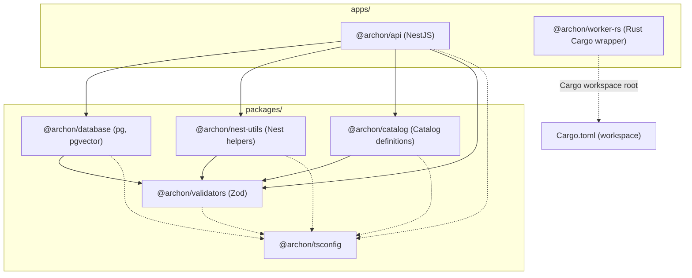

# Design — workspace-scaffold

## 1. Arquitectura General del Monorepo

El proyecto Archon utiliza una arquitectura monorepo híbrida gestionada por **Turborepo** y **pnpm workspaces** para el ecosistema TypeScript/Node.js, complementada por un **Cargo workspace** en la raíz para el componente de alto rendimiento en Rust (`apps/worker-rs`).



---

## 2. Componentes y Paquetes Afectados

### 2.1 `packages/tsconfig` (`@archon/tsconfig`)
- **Propósito:** Proveer configuraciones base y especializadas de TypeScript compartidas en todo el monorepo.
- **Archivos:**
  - `package.json`:
    ```json
    {
      "name": "@archon/tsconfig",
      "version": "0.1.0",
      "private": true,
      "files": ["base.json", "nest.json"]
    }
    ```
  - `base.json`: Configuración estricta genérica (`strict: true`, `target: ES2022`, `moduleResolution: NodeNext`, `module: NodeNext`, `declaration: true`).
  - `nest.json`: Extiende `base.json` con soporte para decoradores requeridos por NestJS (`experimentalDecorators: true`, `emitDecoratorMetadata: true`).

### 2.2 `packages/validators` (`@archon/validators`)
- **Propósito:** Esquemas Zod y tipos compartidos framework-agnostic.
- **Dependencias:** `zod` (`^3.23.8`).
- **Dependencias de desarrollo:** `typescript`, `vitest`, `@archon/tsconfig: workspace:*`.
- **Estructura:**
  - `src/index.ts`: exporta placeholder inicial (`export const SCAFFOLD_VERSION = '0.1.0';` y un esquema base de sanidad).
  - `tests/sanity.test.ts`: verifica la exportación y el validador Zod.
- **Scripts:**
  - `build`: compilación o empaquetado TypeScript (`tsc -p tsconfig.json`).
  - `lint`: linter estático.
  - `typecheck`: `tsc --noEmit`.
  - `test`: `vitest run`.

### 2.3 `packages/database` (`@archon/database`)
- **Propósito:** Infraestructura de persistencia, pool PostgreSQL nativo (`pg`), soporte `pgvector` y migraciones dbmate.
- **Dependencias:** `pg`, `pgvector`, `@archon/validators: workspace:*`.
- **Dependencias de desarrollo:** `@types/pg`, `typescript`, `vitest`, `@archon/tsconfig: workspace:*`.
- **Estructura:**
  - `src/index.ts`: exporta placeholder del servicio/token de base de datos.
  - `tests/sanity.test.ts`: verifica los tipos e importaciones de `pg` y `pgvector`.
- **Scripts:** `build`, `lint`, `typecheck`, `test`.

### 2.4 `packages/nest-utils` (`@archon/nest-utils`)
- **Propósito:** Helpers y utilidades reutilizables específicas de NestJS (como pipes de validación Zod).
- **Dependencias:** `@nestjs/common`, `@nestjs/core`, `@archon/validators: workspace:*`.
- **Dependencias de desarrollo:** `reflect-metadata`, `typescript`, `vitest`, `@archon/tsconfig: workspace:*`.
- **Estructura:**
  - `src/index.ts`: exporta utilidades base o placeholder de sanitización.
  - `tests/sanity.test.ts`: verifica compatibilidad con clases de NestJS y `@archon/validators`.
- **Scripts:** `build`, `lint`, `typecheck`, `test`.

### 2.5 `packages/catalog` (`@archon/catalog`)
- **Propósito:** Definiciones declarativas de tecnologías soportadas y scripts de validación.
- **Dependencias:** `@archon/validators: workspace:*`.
- **Dependencias de desarrollo:** `typescript`, `vitest`, `@archon/tsconfig: workspace:*`.
- **Estructura:**
  - `src/index.ts`: exporta catálogo base o placeholder.
  - `tests/sanity.test.ts`: verifica la carga y tipado del módulo.
- **Scripts:** `build`, `lint`, `typecheck`, `test`.

### 2.6 `apps/api` (`@archon/api`)
- **Propósito:** Servidor NestJS principal (HTTP + servidor MCP remoto).
- **Dependencias:**
  - `@nestjs/common`, `@nestjs/core`, `@nestjs/platform-express`, `reflect-metadata`, `rxjs`.
  - Dependencias de workspace: `@archon/validators: workspace:*`, `@archon/database: workspace:*`, `@archon/nest-utils: workspace:*`, `@archon/catalog: workspace:*`.
- **Dependencias de desarrollo:** `@types/node`, `@types/express`, `typescript`, `vitest`, `@archon/tsconfig: workspace:*`.
- **Estructura:**
  - `src/main.ts`: punto de entrada bootstrap de NestJS.
  - `src/app.module.ts`: módulo raíz mínimo.
  - `tests/app.test.ts`: smoke test que instancia el módulo y verifica resolución de dependencias.
- **Scripts:** `build`, `lint`, `typecheck`, `test`.

### 2.7 `apps/worker-rs` (`@archon/worker-rs` / `archon-worker`)
- **Propósito:** Motor en Rust para extracción, parsing AST, chunking y generación de embeddings.
- **Crate Cargo (`apps/worker-rs/Cargo.toml`):**
  ```toml
  [package]
  name = "archon-worker"
  version = "0.1.0"
  edition = "2021"

  [dependencies]
  ```
- **Código Fuente (`apps/worker-rs/src/main.rs`):**
  Punto de entrada binario básico y test unitario de sanidad con `#[test]`.
- **Wrapper npm (`apps/worker-rs/package.json`):**
  Permite que Turborepo ejecute y cachee las tareas de Rust de forma idéntica al resto del workspace:
  ```json
  {
    "name": "@archon/worker-rs",
    "version": "0.1.0",
    "private": true,
    "scripts": {
      "build": "cargo build",
      "lint": "cargo clippy -- -D warnings",
      "typecheck": "cargo check",
      "test": "cargo test"
    }
  }
  ```

### 2.8 Raíz del Monorepo
- **`Cargo.toml` raíz:**
  ```toml
  [workspace]
  members = [
    "apps/worker-rs"
  ]
  resolver = "2"
  ```
- **`turbo.json` raíz:**
  Garantiza el pipeline para `build`, `lint`, `typecheck` y `test` en todas las apps y packages.

---

## 3. Firmas, Tipos y Schemas Exportados (Scaffold)

### 3.1 Contrato en `@archon/validators`
```typescript
import { z } from 'zod';

export const ScaffoldStatusSchema = z.object({
  package: z.string(),
  initialized: z.boolean(),
  version: z.string(),
});

export type ScaffoldStatus = z.infer<typeof ScaffoldStatusSchema>;
```

### 3.2 Contrato en `@archon/database`
```typescript
export interface DatabasePackageInfo {
  name: string;
  driver: 'pg';
  pgvectorSupported: boolean;
}

export const DATABASE_PACKAGE_INFO: DatabasePackageInfo = {
  name: '@archon/database',
  driver: 'pg',
  pgvectorSupported: true,
};
```

### 3.3 Contrato en `@archon/nest-utils`
```typescript
export interface NestUtilsPackageInfo {
  name: string;
  version: string;
}

export const NEST_UTILS_PACKAGE_INFO: NestUtilsPackageInfo = {
  name: '@archon/nest-utils',
  version: '0.1.0',
};
```

### 3.4 Contrato en `@archon/catalog`
```typescript
export interface CatalogPackageInfo {
  name: string;
  version: string;
}

export const CATALOG_PACKAGE_INFO: CatalogPackageInfo = {
  name: '@archon/catalog',
  version: '0.1.0',
};
```

### 3.5 Contrato en `apps/worker-rs` (`src/main.rs`)
```rust
fn main() {
    println!("archon-worker scaffold initialized");
}

#[cfg(test)]
mod tests {
    #[test]
    fn test_worker_scaffold_sanity() {
        assert_eq!(2 + 2, 4);
    }
}
```

---

## 4. Manejo de Errores y Excepciones

1. **Propagación de Código de Salida:**
   - Turborepo aborta el pipeline cuando un subproceso emite un código de salida `!= 0`.
   - Si `cargo test` o `cargo clippy` detectan errores en `apps/worker-rs`, el script del `package.json` wrapper finaliza con error y Turborepo detiene la ejecución reportando el fallo.
2. **Dependencias Circulares e Inconsistencias de Workspace:**
   - `pnpm` valida el grafo de dependencias de `pnpm-workspace.yaml`. La presencia de ciclos entre paquetes aborta la instalación con error determinista.
3. **Validación Estricta de Tipos:**
   - Con `strict: true` en `@archon/tsconfig`, cualquier transgresión de tipado (e.g. uso de `any`, tipos no resueltos) hace fallar la tarea `typecheck`.

---

## 5. Alternativas Descartadas

### Alternativa 1 (Descartada): Submódulos Git o Polyrepo para `apps/worker-rs`
- **Descripción:** Mantener el crate de Rust en un repositorio de Git separado y vincularlo como submódulo en el workspace.
- **Justificación de Descarte:** Fragmenta el control de versiones y el ciclo CI/CD. Dificulta cambios atómicos coordinados entre los esquemas de validación IPC en TypeScript y los deserializadores en Rust. Impide que un solo comando `pnpm turbo run test` valide la integridad de todo el sistema en una sola pasada.

### Alternativa 2 (Descartada): Invocación directa de comandos `cargo` en scripts raíz sin wrapper `package.json` en `apps/worker-rs`
- **Descripción:** Definir scripts en el `package.json` raíz (`cargo:build`, `cargo:test`) que ejecuten `cargo` directamente, sin registrar `apps/worker-rs` como un workspace de pnpm.
- **Justificación de Descarte:** Turborepo orquesta tareas a nivel de paquete individual. Sin un `package.json` en `apps/worker-rs`, Turborepo no puede indexar el worker como un nodo en el pipeline, impidiendo la ejecución granular con filtros (`--filter=@archon/worker-rs`), el cacheo independiente de compilación de Rust y la integración transparente en `pnpm turbo run lint typecheck test`.
